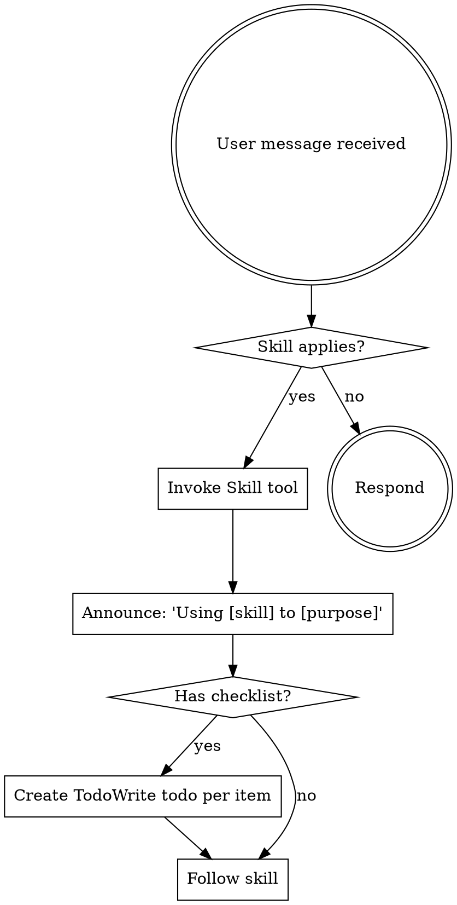

<SUBAGENT-STOP>
If you were dispatched as a subagent to execute a specific task, skip this skill.
</SUBAGENT-STOP>

## Instruction Priority

Skills override Claude Code's default system prompt where they conflict, but user instructions always win:

1. **User's explicit instructions** (CLAUDE.md, GEMINI.md, AGENTS.md, direct requests) — highest priority
2. **Skills** — override defaults where they conflict
3. **Default system prompt** — lowest priority

If CLAUDE.md says "don't use TDD" and a skill says "always use TDD," follow the user.

## How to Access Skills

- **Claude Code**: use the `Skill` tool. Skill content loads when invoked — follow it directly. Don't `Read` skill files.
- **Copilot CLI**: use the `skill` tool — same as Claude Code's `Skill` tool. Skills are auto-discovered from installed plugins.
- **Gemini CLI**: skills activate via `activate_skill`. Gemini loads metadata at session start, full content on demand.
- **Other environments**: check the platform's docs for how skills load.

## Platform Adaptation

Skills use Claude Code tool names. On other platforms, see `references/copilot-tools.md` (Copilot) or `references/codex-tools.md` (Codex) for tool equivalents. Gemini CLI users get the mapping loaded automatically via GEMINI.md.

# Using Skills

## When to invoke

Check the available-skills list when a user request might match one — skill metadata is short, so the cost of checking is low. If a skill's description matches the task, invoke it before doing the work; the skill often tells you *how* to do the task more efficiently than first principles would.

If you check and nothing fits, just proceed normally. No need to force a skill where none applies.

## Skill Priority

When multiple skills could apply:

1. **Process skills first** (brainstorming, debugging) — these shape *how* to approach the task
2. **Implementation skills second** (frontend-design, mcp-builder) — these guide execution

"Let's build X" → brainstorm first, then implementation skills.
"Fix this bug" → debug first, then domain-specific skills.

## Skill Types

- **Rigid** (TDD, debugging): designed to be followed exactly. The discipline is the point.
- **Flexible** (patterns): principles that adapt to context.

The skill itself indicates which type.

## User Instructions

User instructions say *what*, not *how*. "Add X" or "Fix Y" doesn't mean skip workflows the user has set up.
